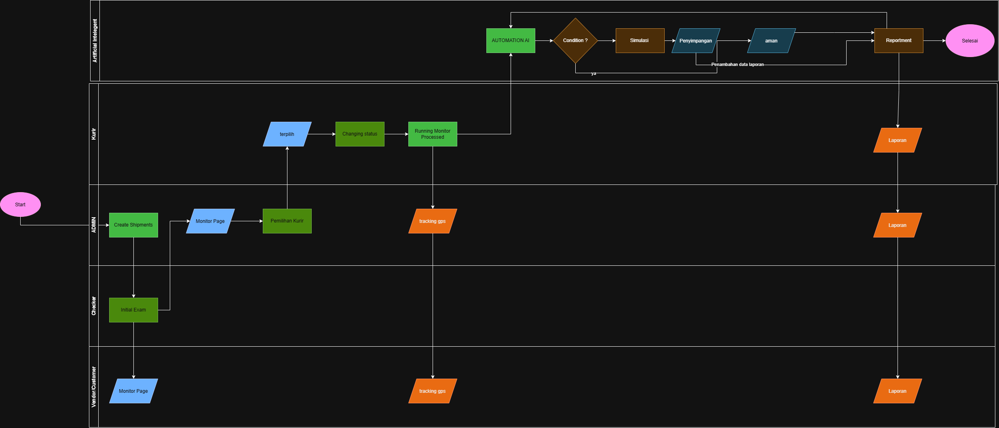

# Pharma Logistics Workflow Architecture
## Anteraja NextGen AI — Central Documentation Hub

Dokumentasi resmi arsitektur sistem, persyaratan produk (*Product Requirement Document* / PRD), spesifikasi fungsional (*Functional Requirement Document* / FRD), serta diagram alur operasional logistik farmasi (*cold-chain*) untuk tim pengembang Anteraja Pharma.

## Scope Aplikasi Client

PRD, enam FRD, dan [diagram alur](./diagrams/flowchart.png) di folder ini menjadi acuan scope UI client. Prioritas prototipe adalah urutan kerja pengiriman: admin mendaftarkan kiriman, checker memeriksa, admin menyetujui dan menugaskan kurir, kurir memperbarui perjalanan, lalu admin/vendor melihat pemantauan dan laporan. Login memakai `POST /api/v1/auth/login` sesuai kontrak backend di [server/docs](../../server/docs); sesi dan role ditangani berdasarkan respons API.

Halaman **Pengguna & Hak Akses** memakai GET/POST /api/v1/admin/users dan PUT /api/v1/admin/users/{id}. Server membatasi endpoint ke Admin aktif, menyimpan hash password, mencabut token saat akses berubah, serta menolak perubahan akses akun sendiri dan akun yang masih memiliki kiriman aktif. Update menyertakan expected_role dan expected_active agar data lama tidak diam-diam menimpa perubahan akun.

Client memakai /api/v1 melalui proxy Vite ke http://127.0.0.1:8000 secara default. Ubah VITE_API_BASE_URL dan API_PROXY_TARGET di client/.env.local jika port backend berbeda; file lokal itu tidak ikut Git. Di laptop Evan, API memakai 127.0.0.1:8180 dan client 127.0.0.1:5173. Jangan menyimpan token Telegram, OpenAI, atau password database dalam variabel VITE_.

## Integrasi UI — 15 Oktober 2026

Branch server-telegram-report-attachments meneruskan integrasi halaman Admin, Checker, Kurir, dan Vendor ke Laravel. Sesi menggunakan Bearer Sanctum, diperiksa ulang melalui /auth/me saat refresh; halaman login tidak menyediakan pemilih role. Request yang ditinggalkan dibatalkan, mutasi mencegah klik ganda, dan retry koneksi mempertahankan request_id untuk payload yang sama.

Admin membuat manifest → Checker mengirim checklist dan foto → Admin memutuskan pemeriksaan dan menugaskan kurir → Kurir menerima tugas, berangkat, mencatat sampel, tiba, dan mengirim POD → Vendor melihat riwayat serta mengunduh PDF. Kiriman asing atau resi yang tidak ada menampilkan error, bukan paket contoh pengganti. Form tidak mengklaim sukses sebelum respons server.

Panel monitor memperbarui data setiap 15 detik saat tab browser aktif, tanpa request yang saling menumpuk; pembaruan dijeda ketika keputusan/kendala sedang ditulis atau disimpan. Simulator hanya tampil jika server mengizinkannya pada kiriman demo. Footer mengadaptasi client/footer-update 527e965 dengan tautan sesuai role dan resi yang sedang dibuka; tautan placeholder, App Store palsu, dan klaim sertifikasi dihapus dari tampilan aktif.

OCR/AI Vision dan koneksi perangkat BLE otomatis belum terintegrasi. Sampel sensor dimasukkan melalui formulir/API, sedangkan tombol lokasi meminta izin Geolocation browser. Grafik memakai sampel tersimpan dan peta menampilkan titik GPS terakhir, bukan rute kurir yang dibuat-buat. Worker Telegram langsung dari Laravel tidak menggunakan n8n. Bot dan upload satu PDF diagnostik sudah dikonfirmasi provider; notifikasi operasional tetap menunggu pemetaan akun penerima. Generator laporan analisis AI belum terintegrasi. Lihat [kontrak API](../../server/docs/operations-api.md), [setup Telegram](../../server/docs/telegram-setup.md), dan [hasil verifikasi](../../server/docs/backend-verification.md).

Jalankan npm run check:templates untuk memeriksa ekspresi seluruh template Vue. npm run build menjalankan pemeriksaan itu sebelum type-check dan build. Kode komponen prototipe yang masih ada di repository tidak menjadi sumber data halaman aktif. PRD, FRD, dan flowchart acuan tidak diubah oleh integrasi ini.

---

## 📁 Struktur Direktori `docs/`

Struktur folder dokumentasi telah ditata secara modular agar mudah ditelusuri dan dipelihara:

```
docs/
├── README.md                                  # Hub & Indeks Utama Dokumentasi (file ini)
├── prd/
│   └── PRD-pharma-logistics.md                # Dokumen PRD Utama (Hackathon Edition)
├── frd/
│   ├── FRD-01-manajemen-pengiriman.md         # Inisiasi Pengiriman & Setup Threshold Suhu
│   ├── FRD-02-pemeriksaan-barang.md           # Pemeriksaan Barang (Initial Exam) & AI Vision
│   ├── FRD-03-penugasan-dan-pelacakan-kurir.md# Penugasan Kurir, Live GPS Tracking & WA
│   ├── FRD-04-automasi-ai-dan-penyimpangan.md # Automasi AI, Deteksi Anomali & Predictive Cold-Chain
│   ├── FRD-05-pelaporan-dan-penutupan.md      # Auto-Report PDF/BAP & Penutupan Pengiriman
│   └── FRD-06-control-panel-simulator.md      # Control Panel Simulator (Hackathon Demo Mode)
├── diagrams/
│   └── flowchart.png                          # Diagram Alur Kerja Sistem (Workflow Architecture)
└── references/
    └── Business_Acumen_Pharma_Anteraja.pdf    # Dokumen Acuan Bisnis & Kepatuhan Farmasi (CPOB/GDP)
```

---

## 📑 Daftar Dokumen Utama

### 1. Product Requirement Document (PRD)
* **[PRD-pharma-logistics.md](./prd/PRD-pharma-logistics.md)**: Dokumen komprehensif yang menguraikan visi produk, ringkasan eksekutif, analisis peran stakeholder, arsitektur teknologi, serta peta jalan (roadmap) 4-hari hackathon.

### 2. Functional Requirement Documents (FRD)
Sistem dipecah ke dalam 6 modul fungsional terintegrasi:

| Modul | Nama Dokumen | Fokus & Tanggung Jawab Utama | Aktor Utama |
| :--- | :--- | :--- | :--- |
| **FR-01** | [FRD-01: Manajemen Pengiriman](./frd/FRD-01-manajemen-pengiriman.md) | Inisiasi resi, konfigurasi batas suhu (`temp_min`/`temp_max`), dan pemicuan tugas awal. | Admin |
| **FR-02** | [FRD-02: Pemeriksaan Barang](./frd/FRD-02-pemeriksaan-barang.md) | Pemeriksaan fisik hub gudang (*Initial Exam*), upload bukti segel/suhu, dan verifikasi AI Vision. | Checker, Admin |
| **FR-03** | [FRD-03: Penugasan & Pelacakan Kurir](./frd/FRD-03-penugasan-dan-pelacakan-kurir.md) | Alokasi kurir, konfirmasi penerimaan, pemancaran telemetry, dan live GPS tracking map. | Admin, Kurir, Customer |
| **FR-04** | [FRD-04: Automasi AI & Penyimpangan](./frd/FRD-04-automasi-ai-dan-penyimpangan.md) | Evaluasi telemetry *stream*, deteksi lonjakan suhu/kerusakan segel, dan *Predictive Cold-Chain Alert*. | Automation AI, Admin |
| **FR-05** | [FRD-05: Pelaporan & Penutupan](./frd/FRD-05-pelaporan-dan-penutupan.md) | Penyusunan otomatis Berita Acara Pemeriksaan (BAP) PDF dan distribusi paralel via WA/Email. | Automation AI, Semua Aktor |
| **FR-06** | [FRD-06: Control Panel Simulator](./frd/FRD-06-control-panel-simulator.md) | Panel kendali simulasi demo hackathon (suhu melonjak, signal drop, fast-forward timeline). | Presenter / Demo Ops |

### 3. Diagram Arsitektur & Alur Kerja
* **[flowchart.png](./diagrams/flowchart.png)**: Diagram arsitektur visual alur kerja interaksi antara Admin, Checker, Kurir, Customer, dan Automation AI Engine.



### 4. Dokumen Referensi Bisnis
* **[Business_Acumen_Pharma_Anteraja.pdf](./references/Business_Acumen_Pharma_Anteraja.pdf)**: Pedoman kepatuhan regulasi farmasi, prinsip Cara Pembuatan Obat yang Baik (CPOB), dan analisis *business impact*.

---

## 🔄 Siklus Hidup & Status Pengiriman (State Machine)

```
[Start: Admin Create Shipment]
               │
               ▼
   `CREATED_AWAITING_EXAM` ──► Checker melakukan Initial Exam
               │
               ▼
  `EXAMINED_PENDING_APPROVAL` ──► Admin Review di Monitor Page
       ├── [Tahan]  ──► `HELD_FOR_INSPECTION`
       └── [Setujui] ──► `APPROVED_READY_FOR_ASSIGNMENT`
                               │
                               ▼ Admin menugaskan kurir
                   `ASSIGNED_COURIER_ACCEPTED`
                               │
                               ▼ Kurir mulai pengantaran
                          `IN_TRANSIT`
                               │
          ┌────────────────────┴────────────────────┐
          ▼                                         ▼
   [Telemetry Normal]                    [Terdeteksi Anomali]
          │                                         │
          │                                         ▼
          │                                 `DEVIATION_HOLD`
          │                                         │ (Admin intervensi & input alasan)
          │                                         ▼
          └────────────────────┬────────────────────┘
                               │
                               ▼
                          `DELIVERED`
                               │
                               ▼ Sistem menerbitkan PDF Laporan Akhir & BAP
                      `COMPLETED_CLOSED`
```

---

## 🛡️ Matriks Hak Akses (Role-Based Access Control)

| Fitur / Modul | ADMIN | Checker | Vendor / Customer | Kurir | AUTOMATION AI |
| :--- | :---: | :---: | :---: | :---: | :---: |
| **Create Shipment & Setup Handling** | ✅ Write | ❌ | ❌ | ❌ | ❌ |
| **Execute Initial Exam & Upload Proof** | ❌ | ✅ Write | ❌ | ❌ | ❌ |
| **Review Exam & Give Approval** | ✅ Write | ❌ | ❌ | ❌ | ❌ |
| **Courier Assignment** | ✅ Write | ❌ | ❌ | ❌ | ❌ |
| **Accept / Reject Assignment** | ❌ | ❌ | ❌ | ✅ Write | ❌ |
| **Update Transit Status & Emit Telemetry** | ❌ | ❌ | ❌ | ✅ Write | ❌ |
| **View Live GPS Tracking & Temp Chart** | ✅ Read | ❌ | ✅ Read | ✅ Read | ✅ Read |
| **Report Field Incident** | ❌ | ❌ | ❌ | ✅ Write | ❌ |
| **Evaluate Anomaly & Trigger Predictive Alert** | ❌ | ❌ | ❌ | ❌ | ✅ Execute |
| **Resolve Incident & Enter Reason Notes** | ✅ Write | ❌ | ❌ | ❌ | ❌ |
| **Generate & Receive Final PDF Report** | ✅ Read | ❌ | ✅ Read | ✅ Read | ✅ Execute |
| **Trigger Demo Simulator (Hackathon Mode)** | ✅ Write | ❌ | ❌ | ❌ | ❌ |

---

## 🌟 Fitur Pembeda Unggulan (Key Differentiators)

1. **AI Vision Inspection (FR-02)**: Pemindaian cerdas terhadap kondisi fisik segel dan pembacaan digit suhu pada termometer analog/digital menggunakan AI Vision / OCR.
2. **Predictive Cold-Chain Engine (FR-04)**: Evaluasi laju kenaikan suhu (*temperature velocity*) untuk memberikan peringatan dini sebelum obat mengalami degradasi mutu.
3. **Control Panel Simulator (FR-06)**: Panel kendali live demo hackathon untuk menguji respons sistem terhadap skenario darurat dalam hitungan detik.
4. **Auto-Report & Parallel Multi-Channel Distribution (FR-05)**: Berita Acara Pemeriksaan (BAP) terbit otomatis berstandar GDP/CPOB dan terdistribusi via WhatsApp, Telegram, dan PDF download.
